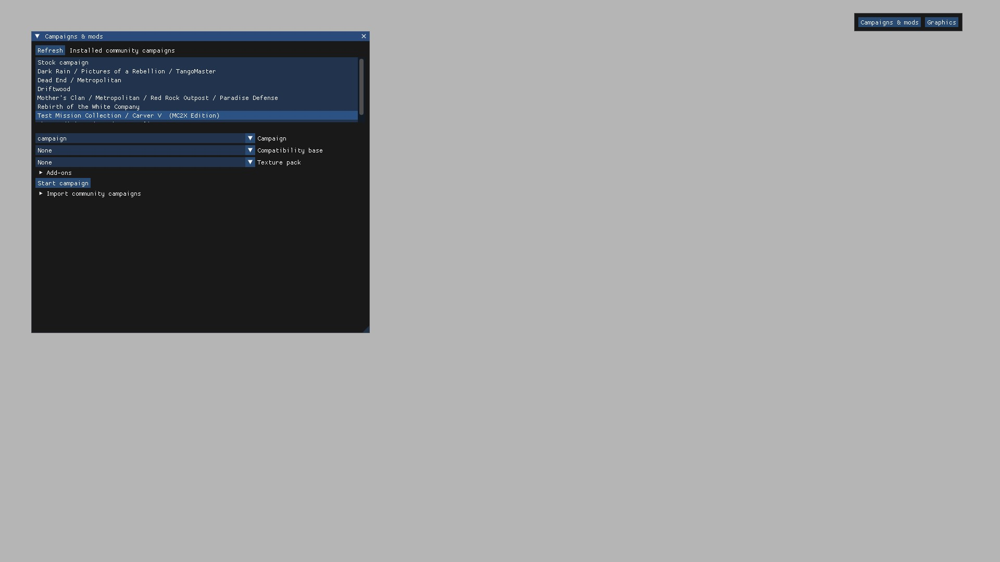

# Import community campaigns

You need an installed copy of this game and Python **3.12 or newer** (python.org;
enable the Windows Python launcher). Keep your original downloads. Importing
copies their content into the game's `mods` folder and leaves the source alone.

Get campaigns from these catalogs; choose the download names in the table below:

https://www.moddb.com/mods/mechcommander-omnitech/downloads
https://www.moddb.com/mods/wolfman-mc2x/downloads
https://www.wolfman-x.net/

For ZIPs or already installed campaign folders, drag the ZIP/folder onto
`import-campaign.bat` beside `mc2.exe`. You can also double-click the BAT and paste
the path **without quotes**. Read the result before closing its window.

For the original Inno Setup EXE downloads, get the Windows ZIP from
https://constexpr.org/innoextract/ and unzip it into a folder on PATH (for example,
put `innoextract.exe` beside `mc2.exe` and run the command from that game folder).
The importer uses it to extract content without running the old installer.
The BAT changes to the game folder automatically, so an `innoextract.exe` beside
it works even when you start the BAT from another folder.
Alternatively, install each original campaign into its own separate folder, then
drag that folder onto the BAT. Extract 7z/RAR downloads first. Never install an old
campaign over this game's folder or over another campaign.

Open Command Prompt in the folder containing `mc2.exe`. In these examples,
`<your Downloads folder>` and `<your Campaigns folder>` mean the folders where you saved the downloads; replace that part of each path.
Every command can also take a separate installed folder instead of the EXE.

Import the compatibility bases first:

```bat
py -3 tools\import_campaign.py "<your Downloads folder>\MCOsetup628.exe"
py -3 tools\import_campaign.py "<your Campaigns folder>\MC2X-CVE-G"
```

The first also imports Omnitech's Exodus and MechWarrior 2 Mercenaries; select
`campaign` or `mw2mercs` in the Campaign dropdown. The second imports MC2X Carver V.

| Campaign download / folder | One command from the game folder |
|---|---|
| Omnitech Carver V original | `py -3 tools\import_campaign.py "<your Downloads folder>\Carver5OForMCOsetup.exe"` |
| Omnitech Modified Carver V | `py -3 tools\import_campaign.py "<your Downloads folder>\CarverVRedux.2.exe"` |
| Wolf Dragoons | `py -3 tools\import_campaign.py "<your Downloads folder>\WolfDragoonsForMCOsetup.exe"` |
| Liberation of Volstand | `py -3 tools\import_campaign.py "<your Downloads folder>\VolstandForMCOsetup.exe"` |
| Mercenaries Star | `py -3 tools\import_campaign.py "<your Downloads folder>\MercStarForMCOsetup.exe"` |
| Desert Fox | `py -3 tools\import_campaign.py "<your Downloads folder>\DesertFoxForMCOsetup.exe"` |
| Day of Heroes | `py -3 tools\import_campaign.py "<your Downloads folder>\DayOfHeroesForMCOsetup.1.exe"` |
| Clan Eagle | `py -3 tools\import_campaign.py "<your Downloads folder>\ClanEagleForMCOsetup.exe"` |
| Laskos Legion | `py -3 tools\import_campaign.py "<your Campaigns folder>\Laskos Legion"` |
| Clan Wars | `py -3 tools\import_campaign.py "<your Campaigns folder>\Clan Wars"` |
| Dead End | `py -3 tools\import_campaign.py "<your Downloads folder>\wolfman-MC2X-DEE.exe"` |
| Driftwood | `py -3 tools\import_campaign.py "<your Downloads folder>\wolfman-MC2X-DWE.exe"` |
| Houdini Project | `py -3 tools\import_campaign.py "<your Downloads folder>\wolfman-MC2X-HPE.exe"` |
| Mother's Clan | `py -3 tools\import_campaign.py "<your Downloads folder>\wolfman-MC2X-MCE.exe"` |
| Rebirth of the White Company | `py -3 tools\import_campaign.py "<your Downloads folder>\wolfman-MC2X-RWC.exe"` |
| TCE: Dark Rain, Pictures of a Rebellion, TangoMaster | `py -3 tools\import_campaign.py "<your Downloads folder>\wolfman-MC2X-TCE.exe"` |
| UpRise | `py -3 tools\import_campaign.py "<your Campaigns folder>\MC2X-URE-G"` |
| TangoMaster standalone edition | `py -3 tools\import_campaign.py "<your Campaigns folder>\MC2X-TME-G"` |
| REAP | `py -3 tools\import_campaign.py "<your Campaigns folder>\MC2X-REAP"` |
| REAP3 | `py -3 tools\import_campaign.py "<your Campaigns folder>\MC2X-REAP3"` |
| Corona Crisis / design test missions | `py -3 tools\import_campaign.py "<your Campaigns folder>\MC2X"` |
| Original Magic Exodus (campaign + mc2_patch.exe in one separate install) | `py -3 tools\import_campaign.py "<your Campaigns folder>\Magic-Exodus"` |
| Magic unofficial expansion (full separate install) | `py -3 tools\import_campaign.py "<your Campaigns folder>\Magic-Expansion"` |
| Legacy Dark Rain | `py -3 tools\import_campaign.py "<your Downloads folder>\Magic_MC2_archive\DarkRain"` |
| Legacy Pictures of a Rebellion | `py -3 tools\import_campaign.py "<your Downloads folder>\Magic_MC2_archive\PicturesOfARebeliion"` |
| Legacy TangoMaster | `py -3 tools\import_campaign.py "<your Downloads folder>\Magic_MC2_archive\TangoMaster"` |

Start the game, open **Campaigns & mods**, press **Refresh**, choose the imported
pack, choose the campaign in its dropdown, choose `mco-compat` for Omnitech or
`mc2x-compat` for Wolfman, and click **Start campaign**. The game restarts to change
content. The editor's mod picker also sees the imported folder.

An unchanged repeat import says `unchanged`; it does not make duplicate mods.
An incomplete download reports the missing first-mission FIT/PAK. This validates
the starting files, not every model or script in every mission. A changed source
version or locally edited installation is refused: preserve your saves and move
that campaign's mod folder aside before importing a replacement. Never delete a
compatibility base while other campaigns depend on it.

An error names the missing file and the source installer or folder. Re-extract
that original download; for missing compatibility content, import the full
`MCOsetup628.exe` (Omnitech) or `MC2X-CVE-G` (Wolfman) first. A mission name alone,
a story outline, or a patch without its full campaign is not a complete download.
The inventory marks editions whose source downloads were unavailable for testing;
the command list is not a claim that every edition has been tested.



The selected pack above contains MC2X Carver V and its test collection. Choose
`main_campaign` and `mc2x-compat` before starting Carver V. This screenshot shows
discovery in the picker; mission compatibility is reported separately.

See [campaign status](campaign-import-status.md) before assuming a campaign works.
